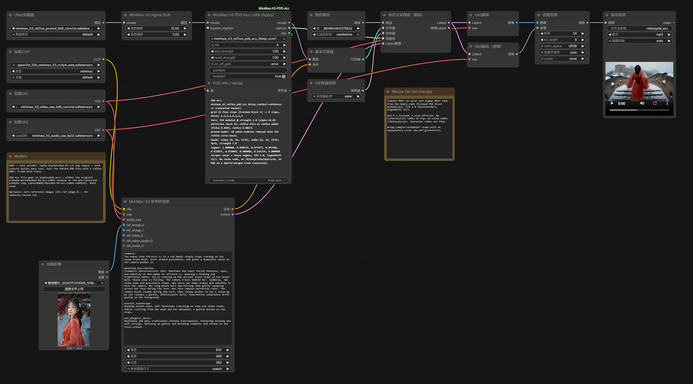
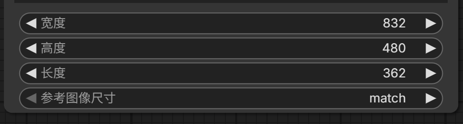

# 16GB 老笔记本 + 雷电 3 外接 RTX 3060，跑通 MiniMax H3 PDD-ACC

> **8 年前的 ThinkPad X1 Carbon（i7-8565U / 16GB）也能跑 8 步视频生成。**
> 核心就三件事：32GB 虚拟内存补足物理内存、一个 `--disable-pinned-memory` 绕开 AIMDO 崩溃、
> PDD-ACC 把采样步数压到 8 步以内。全部为本机实测，不是理论推演。


## 效果先看


▶ **[点这里看 15 秒生成视频（mp4，4.5MB）](assets/demo.mp4)**

## 这篇解决什么问题

| 你遇到的坑 | 本文对应章节 |
|-|-|
| 16GB 内存，模型加载阶段直接崩 | [1.3 加大虚拟内存](#13-关键前置操作加大虚拟内存) |
| `hostbuf_file_reader_read failed` / `error=1450` | [二、ComfyUI 启动参数](#二comfyui-启动参数生死攸关) |
| PDD-ACC 节点装完搜不到、工作流 JSON 拖不进画布 | [三、安装与工作流加载](#三minimax-h3-pdd-acc-插件的安装与工作流加载) |
| 参考图不生效、转身脸崩 | [六、提示词写法](#六实例提示词写法参考图生效的关键) |
| 360 帧爆内存、CPU 温度漂红降频 | [5.2 分辨率与帧数](#52-分辨率与帧数针对硬件) |

## 目录

- [一、硬件与系统准备](#一硬件与系统准备)
- [二、ComfyUI 启动参数](#二comfyui-启动参数生死攸关)
- [三、插件安装与工作流加载](#三minimax-h3-pdd-acc-插件的安装与工作流加载)
- [四、模型文件放置](#四模型文件放置)
- [五、工作流配置与关键参数](#五工作流配置与关键参数)
- [六、提示词写法实例](#六实例提示词写法参考图生效的关键)
- [七、运行监控与风险控制](#七运行监控与风险控制)
- [八、速度预期](#八速度预期)

---

这是一份基于硬件环境（2019 款 X1 Carbon + 雷电 3 外接 RTX 3060 12G）的完整实操教程。核心思路是：**用虚拟内存补足物理内存短板，用启动参数绕过 AIMDO 崩溃，用 PDD 加速把生成步数压到 8 步以内**。

---

## 一、硬件与系统准备

### 1.1 基本配置

| 项目 | 实测配置 |
|-|-|
| CPU | Intel Core i7-8565U @ 1.80GHz，4 核 8 线程，L3 8MB |
| 内存 | 16 GB（Samsung 2×8GB，DDR4-2133，双通道） |
| 独显 | NVIDIA GeForce RTX 3060，12 GB（驱动 621.14，16 W） |
| 核显 | Intel UHD Graphics 620（当前主显示 2560×1440 @60Hz） |
| 硬盘 | SAMSUNG MZVLB1T0HBLR-000L7 NVMe SSD，953.9 GB，HealthStatus = Healthy |
| 网卡 | Intel Wireless-AC 9560 |
| 电池 / 电源 | 96% 电量，电源方案「平衡」 |
| BIOS | LENOVO N2HET85P (1.68)，2026-02-24 |

### 1.2 确认 eGPU 连接

X1 Carbon 2019 款（Gen 7）搭载雷电 3 接口。需要确认：

- **雷电 3 线缆**：使用原装或认证的主动式 Thunderbolt 3 线缆，长度越短越稳定。
- **显卡坞供电**：RTX 3060 峰值功耗约 170W，显卡坞电源建议 ≥ 350W。
- **驱动**：安装 NVIDIA 官方最新驱动，确保设备管理器中能正常识别 RTX 3060。

### 1.3 关键前置操作：加大虚拟内存

物理内存只有 16GB，而 H3 的文本编码器暂存约 15GB、扩散模型暂存约 20GB。**不设置虚拟内存，工作流在加载阶段就会崩溃**。

操作路径（Windows 10/11）：

1. 右键“此电脑” → 属性 → 高级系统设置 → 性能“设置” → 高级 → 虚拟内存“更改”。
2. 取消勾选“自动管理所有驱动器的页面文件大小”。
3. 选择**你速度最快的固态硬盘**（建议 C 盘或 F 盘，确保有 ≥ 60GB 空闲空间）。
4. 选择“自定义大小”，**初始大小和最大值都填 32768 MB（32GB）**。空间充裕可填 40960 MB（40GB）。
5. 点击“设置” → 确定 → 重启电脑。

### 1.4 电源与散热设置

- **电源模式**：设置为“最佳性能”或“高性能”。
- **限制 CPU 最大频率**（强烈建议）：控制面板 → 电源选项 → 更改高级电源设置 → 处理器电源管理 → 最大处理器状态，改为 **99%**。关闭睿频，让 i7-8565U 从 100°C 降到 80°C 左右，对生成速度影响极小。
- **物理散热**：垫高笔记本尾部，确保底部进风。用小风扇对着键盘左上角吹。

---

## 二、ComfyUI 启动参数（生死攸关）

你使用的是 Comfy Desktop。在启动参数输入框中，填入以下内容（保留原有的 `--enable-manager`）：

```text
--enable-manager --disable-pinned-memory
```

**为什么必须加 `--disable-pinned-memory`**：

ComfyUI 在 Windows 上默认使用“固定内存”来加速模型权重传输。但在 16GB 物理内存 + eGPU 的场景下，这个机制会触发 `hostbuf_file_reader_read failed` 或 `error=1450`（系统资源不足）。禁用固定内存是此类崩溃的直接解决方案。

**备选参数**：如果仍报错，可追加 `--disable-dynamic-vram`。这会关闭 AIMDO 动态显存流式加载，回到传统加载方式，代价是显存和内存占用更高、启动更慢。

---

## 三、MiniMax H3 PDD-ACC 插件的安装与工作流加载

PDD（并行解码）加速不能靠普通的 LoRA 加载器读取，必须安装专用的节点包，并加载官方提供的模板。

### 3.1 安装 PDD-ACC 自定义节点

1. 打开 PowerShell。
2. 进入 ComfyUI 的自定义节点目录（请根据实际安装路径调整）：

   ```bash
   cd "F:\Comfy-Desktop\ComfyUI-Installs\ComfyUI\ComfyUI\custom_nodes"
   ```
3. 克隆官方节点仓库：

   ```bash
   git clone https://github.com/Jalen-Brunson/ComfyUI-MiniMax-H3-PDD-Acc
   ```
4. 彻底重启 ComfyUI。在画布双击搜索 `MiniMaxH3PDDAccApply`，如果能搜到，说明插件加载成功。

### 3.2 加载工作流模板（不要拖拽）

插件自带官方示例工作流，位于：

`ComfyUI/custom_nodes/ComfyUI-MiniMax-H3-PDD-Acc/example_workflows/`

推荐使用 **`pdd_acc_t2v_basic.json`**。由于部分 ComfyUI 前端版本存在 Bug，**直接拖拽 JSON 文件到画布可能会显示“禁止”符号**。正确的加载方式是：

1. 在 ComfyUI 界面左上角点击 **“工作流”**（Workflow）菜单。
2. 选择 **“打开”**（Open），或按快捷键 `Ctrl + O`。
3. 在弹出的文件选择窗口中，找到并选中 `pdd_acc_t2v_basic.json` 文件，点击打开。

加载后，原本的“文生视频”工作流，只要你把参考图连入 `ref_image_0`，并在提示词中正确引用，它就能变成“图生视频”。

以下是工作流完整视图



---

## 四、模型文件放置

根据工作流（Ref2VA 参考生视频），需要以下文件：

| 文件 | 放置目录 |
|-|-|
| `minimax_h3_ref2va_pruned_int8_convrot.safetensors` | `ComfyUI/models/diffusion_models/` |
| `qwen3vl_32b_minimax_h3_nvfp4_awq.safetensors` | `ComfyUI/models/text_encoders/` |
| `minimax_h3_video_vae_int8_convrot.safetensors` | `ComfyUI/models/vae/` |
| `minimax_h3_audio_vae_fp32.safetensors` | `ComfyUI/models/vae/` |
| `minimax_h3_ref2va_pdd_acc_8step_comfyui.safetensors` | `ComfyUI/models/pdd_acc/` |

**配对铁律**：Ref2VA 的 PDD 文件**必须**搭配 Ref2VA 的 UNET，FL2VA 同理。配错了不会报错，但画面会静默崩坏。PDD Apply 节点里的 `partition check` 设为 `error` 时，会帮你拦截这个错误。

---

## 五、工作流配置与关键参数

### 5.1 必须遵守的“死规定”

PDD 加速节点输出的 `info` 会明确告诉你规则，核心几条：

- **采样器**：必须选 `euler`。
- **Sigmas**：必须来自 `MiniMaxH3PDDAccApply` 的 `sigmas` 输出，**不要**用 BasicScheduler。
- **CFG**：使用 `BasicGuider`（CFG 1.0），不要用带负面提示词的 CFGGuider。
- **SigmaShift**：视频 12.0，音频 3.0。
- **NFE**：8（或 4）。
- **不要**叠加任何其他加速 LoRA（turbo、lightx2v 等），**不要**加 EasyCache 等缓存节点。

### 5.2 分辨率与帧数（针对硬件）

- **分辨率**：起步用 **832×480** 或 **768×432**。宽高必须是 32 的倍数。想提升清晰度可以试 1024×576，但 360 帧下爆内存风险极高。
- **帧数（length）**：必须是 **8n + 4**。常见值：`124`（约 5 秒）、`168`（约 7 秒）、`248`（约 10 秒）、`360`（约 15 秒，你已跑通）。
- **长视频建议**：360 帧对 16GB 内存压力极大。如果中途崩了，降回 248 帧分两段生成，后期拼接。默认的长度是120（帧）-5秒，我调整到了360，节点自动改成362。

  

---

## 六、实例：提示词写法（参考图生效的关键）

H3 的参考图**不会自动生效**。你必须在提示词中用 `<Picture 1>` 引用它。使用四段式结构：

```text
summary:
The woman from <Picture 1> in a red Hanfu runs up the snowy Great Wall, then turns and smiles as the camera pushes in.

detailed_description:
Cinematic photorealistic shot. Maintain the exact facial features, eyes, and identity of the woman in <Picture 1>. She wears a flowing red traditional Hanfu and runs up ancient stone steps. Heavy snow falls. The camera tracks behind her. She slows down and gracefully stops, then turns slowly to face the camera. Her long black hair and falling snow sweep across her face during the turn. Her face remains clear. The camera holds steady during the turn, then slowly pushes in for a close-up as she reveals a gentle smile.

overall_soundscape:
Howling winter wind, soft footsteps crunching on snow and stone, fabric rustling, a gentle breath as she stops.

non_diegetic_music:
Emotional traditional Chinese instrumental, Guzheng and soft strings, becoming romantic and serene.
```

**针对“转身脸崩”**：把“转身”描述为 `turns slowly and smoothly`，加入头发/雪花遮挡。如果仍崩，把 `SigmaShift` 的视频偏移从 12.0 降到 **9.0 或 10.0**。


---

## 七、运行监控与风险控制

### 7.1 跑之前检查

- 关闭浏览器、微信等占用内存的软件。
- 确认虚拟内存已设置且硬盘有足够空间。
- 确认启动日志中 `Arguments` 包含 `--disable-pinned-memory`。

### 7.2 跑的时候观察

- **任务管理器 → 性能 → 内存**：看“已提交”是否逼近上限。
- **HWiNFO**：CPU Package 温度长期 95°C 以上，考虑垫高/吹风。
- **不要关笔记本盖子**，不要拔雷电 3 线。

### 7.3 如果报错

- **`hostbuf_file_reader_read failed`**：确认参数已生效；仍报错则加 `--disable-dynamic-vram`，或降低分辨率/帧数。
- **`mat1 and mat2 shapes cannot be multiplied`**：检查 CLIPLoader 的 type 是否设为 `minimax`。

---

## 八、速度预期

这套配置跑 H3 PDD 8 步，单次 124 帧可能需要数分钟到十几分钟，360 帧会显著更久。这是硬件瓶颈决定的，不是设置问题。

跑以上实例花15分钟，第一次比较快（10分钟左右），第二次调整转身花脸问题因CPU温度漂红，自行降频，慢了点。

以下是第二次跑的视频

▶ **[观看第二次生成的演示视频（pdd_acc_00005_.mp4，832×480，4.5MB）](assets/demo.mp4)**

---

## 说明

本文是个人实操记录，配置、报错与耗时均以本机实测为准；模型文件与 PDD-ACC 插件版权归各自作者所有。
硬件为 2019 款 ThinkPad X1 Carbon Gen 7 + 雷电 3 显卡坞 + RTX 3060 12G，换配置请自行调整虚拟内存与帧数。

如果这篇帮你少踩一个坑，欢迎点个 Star，也欢迎提 Issue 补充你的踩坑记录。
